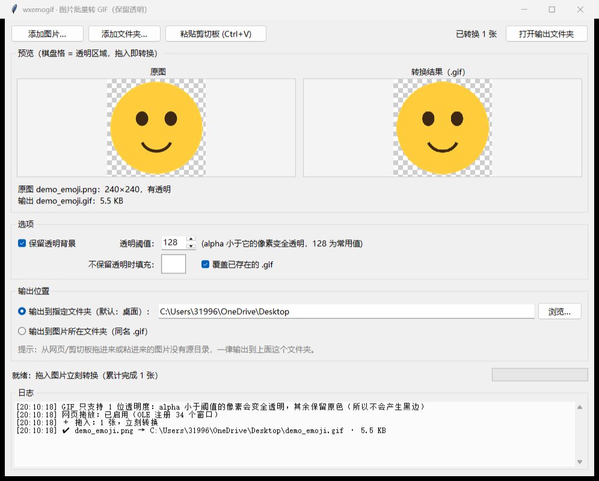

# wxemogif —— 图片拖进来就转 GIF（保留透明）

一个极简的窗口小工具：**把图片拖进来，立刻转成 GIF**，透明背景尽可能原样保留。
没有列表、没有待办队列、不用点「开始转换」——拖一张转一张。



```
wxemogif/
├── wxemogif.py     主程序（界面 + 转换核心，无第三方界面库）
├── ole_dnd.py      OLE 拖放支持（收浏览器拖过来的网页图片）
├── 启动.bat         双击启动（自动找 python）
├── build_exe.py    打包脚本（生成图标 + 调用 PyInstaller）
├── 打包exe.bat      双击打包
├── app.ico         程序图标（由 build_exe.py 生成）
├── docs/           截图等文档素材
├── requirements.txt
└── README.md
```

> 打包好的单文件 exe 不在仓库里（体积原因）。想要的话执行 `python build_exe.py`，
> 或者从 [Releases](../../releases) 下载。

---

## 快速开始

**方式一：直接用打包好的 exe**（推荐，目标机器不需要装 Python）

双击 `dist/wxemogif.exe`。整个程序就这一个文件，拷到哪都能跑。

**方式二：从源码运行**

```bat
pip install -r requirements.txt
python wxemogif.py
```

Windows 下也可以直接双击 `启动.bat`。

需要 Python 3.8+ 和 Pillow（只用到这一个第三方库）。拖拽是直接调用 Win32 API 实现的，
**不需要安装 tkinterdnd2 之类的额外组件**。

---

## 怎么用

**把图片拖进窗口 → 立刻转换完成。** 就这一步。

| 添加方式 | 操作 |
| --- | --- |
| 拖入 | 图片文件、整个文件夹，或者**从浏览器网页上直接把图片拖进来**。拖到窗口哪里都行。文件夹会递归扫描里面的所有图片。 |
| 导入 | 「添加图片…」可多选；「添加文件夹…」整个目录。选完立刻转换。 |
| 粘贴 | 按 `Ctrl+V`。支持截图工具/浏览器复制来的位图，也支持在资源管理器里 `Ctrl+C` 复制的文件，以及复制的一段文件路径文本。 |

转完窗口上半部分会并排显示 **原图** 和 **转换结果**（都用棋盘格衬底，一眼就能看出透明
区域对不对），下面一行给出原图尺寸、透明情况和输出文件的大小。

其它快捷键：`Ctrl+V` 粘贴；`Enter` 没用（没有列表可操作）。

几个说明：

* 一次拖进来多张（或拖一个文件夹）时，会**排队一张一张转**，界面上不显示队列。
* 上一张还在转的时候又拖进来，新的会排在它后面，不会丢也不会互相干扰。
* 同一个文件拖两次会转两次（后一次覆盖前一次），不会因为「已在处理过」被拦住。

---

## 从网页拖图片

浏览器拖网页上的图片走的是 **OLE 拖放**（`IDropTarget`），跟资源管理器拖文件用的
`WM_DROPFILES` 完全是两套机制。本工具两种都实现了，所以：

* 从 Chrome / Edge / Firefox 里直接把网页上的图片拖进窗口 → 用图片的**原始字节**
  （PNG 的透明通道、动图的每一帧都完整保留），文件名也照搬网页上的名字。
* 拖网页上的**动图（GIF）**进来：本来就是 GIF，没必要重编码，会直接复制到输出目录。
* 如果浏览器只肯给一个图片地址（少数情况），程序会自动去下载。
* 输出文件名 = 网页上的文件名，例如拖 `emoji.png` 进来就得到 `emoji.gif`。

程序启动时会往日志里写一行「网页拖放：已启用（OLE 注册 N 个窗口）」，
如果显示不可用，说明 OLE 初始化失败（极少见），此时仍可用按钮导入或 `Ctrl+V`。

---

## 输出规则

**默认输出到桌面**，文件名跟源文件同名，只把扩展名换成 `.gif`：

```
C:\任意位置\cat.png   ->   桌面\cat.gif
网页上拖来的 dog.webp  ->   桌面\dog.gif
```

想改成「放在图片旁边」就把「输出位置」切成 **输出到图片所在文件夹（同名 .gif）**：

```
D:\pics\cat.png   ->   D:\pics\cat.gif
```

从网页或剪切板进来、粘贴进来的图片本身没有源目录，一律输出到上面那个文件夹
（也就是默认的桌面）。

几条约定：

* 本地输入本来就是 `.gif` 的会**跳过**，不会被自己覆盖（日志里显示「跳过」）。
* 网页/剪切板来的 `.gif` 是**直接复制**过去，不是跳过。
* 已经存在的同名 `.gif` 默认覆盖；不想覆盖就把「覆盖已存在的 .gif」取消勾选。
* 写文件是先写临时文件再原子替换，中途出错不会把原有的 `.gif` 写坏。

---

## 透明度是怎么保的

GIF 格式只支持 **1 位透明度**：一个像素要么全透明，要么完全不透明，没有半透明。
所以处理上做了这些事：

1. **调色板留位**：最多用 255 种颜色 + 1 个专门的「透明色」索引（共 256），
   颜色名额一点都不浪费在透明上。
2. **不做黑白混合**：半透明像素**不会**先和黑底/白底混合再量化
   ——那样会在边缘留下黑边或白边光晕。做法是保留像素原本的 RGB，只把
   `alpha < 阈值` 的像素改成透明。所以放在深色背景或浅色背景上都不会有脏边。
3. **透明像素不占颜色**：量化之前先把要变透明的像素涂成不透明区域的平均色，
   避免它们把调色板名额抢走。
4. **动画一致性**：只要文件里任意一帧有透明像素，所有帧都会预留同一个透明索引，
   并写入 `disposal=2` + `background=透明索引`，避免播放时透明区域被背景色填掉。
5. **多帧保留**：动画 WebP / APNG / GIF 会逐帧转换并保留帧数和每帧时长，输出动画 GIF。
6. **浏览器位图**：网页拖来的 32 位 `CF_DIB` 位图，第 4 个字节就是 alpha；
   Pillow 默认会把它当填充丢掉，这里是自己解的，所以透明不会丢。

**局限**：GIF 天生没有半透明。原图里 alpha 在 0~255 之间的柔和边缘，
转换后会按阈值二值化（默认 128：≥128 视为不透明，其余变透明）。
想保留柔和边缘又不受背景影响，唯一的办法是输出 PNG/WebP，而不是 GIF。

---

## 选项

| 选项 | 说明 |
| --- | --- |
| 保留透明背景 | 默认开启。关掉则把所有透明区域填充成下面选的颜色。 |
| 透明阈值 | 默认 128。alpha 小于它的像素变全透明。调小→保留更多半透明像素（边缘更实），调大→抠得更干净。 |
| 不保留透明时填充 | 关掉「保留透明背景」时用的背景色，默认白色。 |
| 覆盖已存在的 .gif | 默认开启。 |
| 输出位置 | 默认「输出到指定文件夹」，路径就是**桌面**；可切换成「输出到图片所在文件夹」。 |

改完选项后再拖图片就按新设置转，不用重启。

---

## 命令行模式

不打开界面，直接批量转换（适合脚本调用）：

```bat
rem 输出到源文件同目录
python wxemogif.py --cli 图片目录

rem 指定输出目录
python wxemogif.py --cli --outdir D:\out *.png

rem 其它参数
python wxemogif.py --cli --threshold 200 --no-alpha --no-overwrite 图片目录
```

`python wxemogif.py 图片1.png 图片2.jpg` 也可以：正常打开界面，并立刻转换这两张。

---

## 自己打包成 exe

双击 `打包exe.bat`，或者：

```bat
python build_exe.py             # 单文件 exe -> dist\wxemogif.exe（默认，约 30 MB）
python build_exe.py --onedir    # 打包成文件夹 -> dist\wxemogif\（启动更快）
python build_exe.py --console   # 保留控制台窗口，方便看报错
```

脚本会自动装 PyInstaller（没装的话）、生成 `app.ico`、然后打包。

单文件 exe 每次启动都要把自己解压到 `%TEMP%`，所以**首次启动会慢 1~3 秒**，
而且个别杀软/公司管控环境会拦截往临时目录解压（表现为双击没反应）。
遇到这种情况改用 `--onedir` 版本，它不往临时目录写东西，启动也快得多。

> 打包出来的 exe 用的是 `--windowed`（无控制台）。如果你还想用命令行的
> `--cli` 模式，程序会自动挂到调用它的 cmd/PowerShell 控制台上，输出照常显示。

---

## 常见问题

**从网页拖图片没反应？**
先看日志里那行「网页拖放：已启用／不可用」。显示已启用还不行的话，多半是浏览器
把图片放在了剪贴板/下载而不是拖放数据里——可以改用右键「复制图像」再 `Ctrl+V`，
或者先存到本地再拖进来。另外，从**以管理员身份运行的浏览器**往普通权限的窗口拖，
Windows 会拦住（UAC 隔离），反过来也一样，两边权限要一致。

**拖文件进去没反应？**
拖拽是把窗口里所有控件都注册成拖放目标（Tk 的每个控件都是独立 HWND，
只注册主窗口的话拖到预览区上不会触发）。如果日志里出现「拖拽目标注册失败」，
用「添加图片…」或 `Ctrl+V` 一样能干活。

**转换后文件反而变大了？**
正常。GIF 是 256 色调色板格式，对照片这类颜色丰富的图，压缩率不如 JPEG。
它是为图标、表情、线稿这类图设计的。

**想反悔上一次转换？**
没有撤销，但输出是覆盖写，重新拖一次换个设置再转就行。

**想改尺寸 / 压缩体积？**
本工具不改尺寸，只做格式转换。需要缩小可以先批量缩放再转换。
